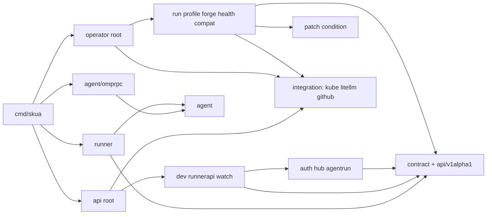

Status: done
Updated: 2026-11-04
Owner: orchestrator

# Proposal: code structure by component and feature slice

## Recommendation

Organize the Go code as **component first, feature slice second**. Two grouping folders hold what the components share: `internal/contract` (types and names the components agree on) and `internal/integration` (clients of external systems).

- **Packages and files:** each slice is a package named for one feature (`run`, `forge`, `dev`, `runnerapi`), with its own `Deps` and `Setup` or `Register`. Inside a slice, each file holds one concern and is named for it.
- **Tests:** plain unit tests sit beside the code. Every test that boots a Kubernetes API server lives in a black-box suite under `test/integration`.
- **Fakes:** one rule. A fake is `<pkg>test` beside the package it fakes, or `test/fakes/<system>` when it runs as its own process.
- **Enforcement:** a `test/layout` Go test checks the import rules, so the layout cannot drift.
- **`hack/` goes away:** the shell scripts become Go programs on kind's Go library and the pinned `helm` and `flux` CLIs. mise pins every tool binary, and Make stays as the entry point.

Key tradeoff: about 120 files move or split with no behaviour change, and every step ships green. Paths then say which component and feature they serve, and a test keeps them that way.

Calls needed: approval, and Q9 (one line in `extension/`).

## Problem

- **Files mix concerns.**
  - `internal/runner/runner.go` (792 lines) holds nine concerns.
  - `internal/api/runner.go` (610) mixes TokenReview, the version gate, three routes, assignment and token push.
  - `internal/api/dev.go` (518) mixes four commands, four queries, JSON helpers and ownership.
  - `internal/operator/run_controller.go` (441) holds admission, the gateway key, the claim, finish, retention and finalize.
- **One package per component.** `internal/operator` holds four controllers. `internal/api` holds dev routes, runner routes, auth, the hub and the informer watch.
- **`internal/` mixes four kinds of package at one level:** components, integrations (`litellm`, `github`), contract packages (`wire`, `sandbox`, `config`) and test helpers.
- **Fakes follow four conventions.** They live in three homes (`internal/testing/*`, `internal/<pkg>/<pkg>fake`, `internal/runner/apiclient/fakeapi`), use two name orders, and put the process fakes inside the e2e suite.
- **App packages hold heavy tests.** `internal/operator` and `internal/api` boot API servers, and their tests read private state such as `hub.pods`.
- **`hack/` is 1,258 lines of shell.** It parses YAML and Corefiles with `sed` (`up.sh:238,267,313-314`), hand-rolls retries and `openssl` certificates, and has a bash YAML parser for pins (`check-pins.sh:94-130`). Nothing runs that parser against its 17 fixtures.
- **Contract strings are duplicated.** The runner endpoint paths appear three times (`apiclient/client.go:28-30`, `fakeapi.go:21-23`, `api/runner.go:107-109`). Refusal reasons are written into fakes and e2e tests (`fakeapi.go:284,359`, `security_test.go:77,96`). Pod env names appear twice (`mcp/server.go:20-21`, `omprpc/config.go:124`). The scheme is built three times (`cmd/skua/api.go:118`, `operator/manager.go:110`, `testenv.go:168`).

## Constraints

- (dev) Component first, then feature slices, with a small shared domain on top (D-1).
- (dev) One binary and one image (D-2).
- (dev) Use maintained tools where one exists, Go for the rest (D-3).
- (dev) Scope is Go code, tests and fakes, `hack/` and tooling. The TypeScript extension is out (D-4).
- (dev) Content stays. This is about organization and readability.
- (dev) Library-first rule for protocol and security code (`AGENTS.md`).
- (dev) Test budgets: `make test` under 60 s, kind tests about 90 s. No nightly jobs and no long-test flags.
- (inferred) Go idioms:
  - Short noun package names, and no `util` package.
  - No import cycles.
  - Interfaces are declared by the code that uses them.
  - Test doubles are named `<pkg>test`, as with `net/http/httptest`.
  - `_test.go` files never reach the binary.
- (dev) Use the latest Go release (1.27.3 on 2026-11-04). The bump lands first and on its own. After it, no step changes a module the `skua` binary links (D-15).

## Design

### Rules

1. **Contract** (`internal/contract/...`, `api/v1alpha1`) holds the types and names that two or more components must agree on. It imports no component.
2. **Integration** (`internal/integration/...`) holds clients of one external system, with no skua logic. The Kubernetes scheme lives here as `kube.Scheme()`.
3. **Components** are `internal/operator`, `internal/api` and `internal/runner`.
   - The root does wiring only. It maps its own `Deps` onto each slice's `Deps` and calls the slice's `Setup` (operator) or `Register` (api).
   - api slices register on a small `Handle(pattern string, h http.Handler)` interface, so they never import the root.
4. **Slices** import contract, integration and their component's support packages. Those support packages are a closed list:
   - operator: `patch`, `condition`
   - api: `auth`, `hub`, `agentrun`

   A slice never imports a sibling slice or its root. Where one slice needs another, it declares the interface it needs. Example: `profile` declares the two compat methods it uses, and the root passes in the `compat.Check`.
5. **Files:** one concern per file, named for it. A file over 300 lines is flagged in review. In an HTTP slice, each command (`create.go`, `steer.go`, `abort.go`) and each query (`runs.go`, `events.go`, `profiles.go`) is its own file. This is a CQRS-style split without a mediator or bus. Unit tests mirror the source files.
6. **Tests:** unit tests sit beside the code, with no API server and no network beyond `httptest`. Every envtest-based test is a black-box suite under `test/integration/<area>` that uses only exported APIs. Suites that need a single controller call that slice's `Setup`. Only the stack suite uses `operator.Register` and `api.New`.
7. **Test doubles:** an in-process fake is package `<pkg>test` in `<pkg>/<pkg>test/`. A process-level fake lives in `test/fakes/<system>/`. It is a thin `main.go` over a `<pkg>test` library, or, when nothing in-process uses it, a `package main` split one concern per file.
8. **Enforced by `test/layout`:** a Go test reads `go list -deps -json ./...` and fails when:
   - contract imports a component
   - a slice imports a sibling or its root
   - a slice imports a support package outside the closed list
   - `testenv` is imported outside `test/integration`
   - a fake package's name does not end in `test`

### Target tree

```
cmd/skua/                      dispatcher; runner.go builds the agent adapter (agent/omprpc) and passes it to runner.Main
api/v1alpha1/                  CRD types, labels, reasons                     [contract]
internal/
  contract/
    wire/                      dev.go events.go runner.go commands.go paths.go refusal.go ssewriter.go ssereader.go
    sandbox/                   pod contract: names.go (Name, SecretName) labels.go secret.go pod.go (layout, env) lookup.go
      sandboxtest/             agent-sandbox fake (was internal/testing/sandboxfake)
    config/
  integration/
    kube/                      Scheme()
    litellm/   litellmtest/    admin client; the fake also serves the LLM upstream (was internal/testing/fakellm)
    github/    githubtest/     App token minter and its fake
  operator/                    root: operator.go (Run, Register, Deps) cache.go (CacheOptions) gatewaykey.go
    run/                       setup.go reconciler.go admit.go key.go claim.go finish.go retention.go
    profile/                   setup.go reconciler.go readiness.go apply.go template.go pool.go network.go
    forge/                     setup.go reconciler.go mint.go revoke.go secret.go
    health/                    setup.go reconciler.go pod.go
    compat/                    check.go installed.go (agent-sandbox version check; started by Run only)
    patch/  condition/         support: status patch, FailRun; condition Set, FailingSince
  api/                         root: server.go (New, Serve, Deps incl. Hub and TokenReviews) health.go streams.go
    dev/                       register.go create.go steer.go abort.go runs.go events.go profiles.go owned.go json.go
    runnerapi/                 register.go gate.go stream.go events.go result.go assign.go refusal.go
    watch/                     watch.go project.go
    auth/      authtest/       bearer.go oidc.go tokenreview.go; OIDC issuer and TokenReview fakes
    hub/                       hub.go eventlog.go commands.go
    agentrun/                  view.go finish.go
  runner/                      one package split by file: runner.go state.go layout.go settings.go command.go drive.go
                               attempt.go result.go report.go agentenv.go credential.go workspace.go outputs.go skill.go install.go
    agent/                     port: Adapter, StartParams, TurnResult, Error
      omprpc/  omprpctest/     omp adapter split: agent.go process.go chunk.go reason.go config.go events.go; omp fake
    apiclient/ apiclienttest/
    mcp/  gitcred/  proc/
  testenv/                     envtest boot; imported only by test/integration
  version/
test/
  integration/                 the in-process stack suites (as today)
    operator/                  controller suites, one slice Setup each, plus the generated-RBAC cache test
    api/                       HTTP suites through api.New with an injected Hub and TokenReviews fake
    crd/                       CEL validation (was api/v1alpha1/cel_test.go)
    sandboxtest/               the agent-sandbox fake's own envtest checks
  layout/                      import-rule test
  e2e/  install/  pins/  chart/  manifests/
  kindenv/                     library: kind Go library + exec of pinned helm; manifests embedded
  fakes/  forge/  llm/  omp/   process fakes with their Dockerfiles
tools/  kindenv/ testbudget/   up | down | load | logs | footprint; go test -json budget
mise.toml                      pins omp, golangci-lint, helm, kustomize, kind, kubectl, flux, shellcheck, zizmor; tasks call make
Makefile                       entry points unchanged; tools from mise and go tool
```

### Import direction



`tools/` and `test/` are never imported by `internal/` or `cmd/`.

### Seams fixed by the move (no behaviour change)

- **Adapter selection:** `agent.Error` replaces `omprpc.Error`. `NewAdapter` moves to `cmd/skua`, and `runner.Main` takes an `agent.Adapter`, so `runner` no longer imports `omprpc`. `PI_CODING_AGENT_DIR` moves from the agent-neutral env (`runner.go:715`) into `omprpc`.
- **Single constants:**
  - Endpoint paths and refusal reasons become one exported constant each in `wire`. `runnerapi` exports its result body limit.
  - The pod env names (`SKUA_RUNNER_SOCK`, `SKUA_RESULT_SCHEMA_FILE`, `SKUA_FORGE_TOKEN_FILE`) become one constant each in `contract/sandbox`.
  - The operator's finalizer, Secret key, condition and field-manager names that the moved suites assert are exported by their slice.
- **Process code:** `runCommand` (`workspace.go:115-161`) becomes `proc.Run`, and `proc.Install` becomes `runner.Install`.
- **Atomic writes:** `atomicfile` is replaced by renameio v2.0.2. Each write calls `renameio.NewPendingFile(path, renameio.WithStaticPermissions(mode), renameio.WithTempDir(filepath.Dir(path)))`, then `io.Copy`, then `CloseAtomicallyReplace`. That keeps today's exact modes, the same-directory temp file, and streaming of the runner binary.
- **Shared assembly:** `cmd/skua` and the stack suite both call `api.New` and `operator.Register`, so neither duplicates the wiring.
- **One scheme:** `kube.Scheme()` replaces the three copies.
- **Tests that read private state:** `TestRunnerRoutesForgetDropsPodStateInEitherOrder` moves to `runnerapi` and asserts the hub side through behaviour (`Send` fails after `Forget`). The other hub-internal checks become `hub` unit tests.

### Tooling

|Today|Replacement|Notes|
|---|---|---|
|`hack/kind/up.sh`, `down.sh` (392 lines)|`tools/kindenv` over `test/kindenv`: kind's Go library `sigs.k8s.io/kind/pkg/cluster` v0.33.0, plus exec of the pinned `helm` CLI|No Helm SDK, so no module drift. It still writes the `KEY=VALUE` `/tmp/<cluster>.env` that the Makefile and e2e read, and adds a JSON state file for footprint|
|`check-agent-sandbox-upgrade.sh`, `check-flux-example.sh`, `check-ingress-stream.sh` (498)|Go tests in `test/install` (tag `install`) on `test/kindenv`. `flux` and `helm` are exec'd; certificates come from `crypto/x509`|Same assertions, with typed reads in place of `jsonpath`|
|`check-pins.sh` and 17 fixtures|zizmor v1.32.0 (`unpinned-uses`) for workflows; `test/pins` for Dockerfiles, Helm values, kindenv images and docs examples, with the fixtures as testdata|No auto-update (D-8)|
|`test-budget.sh`, `testbudget/`|`tools/testbudget`|gotestsum and tparse have had no release in 12 months|
|`install-omp.sh`, Makefile `download-tool` macros, `kind-prereqs` downloads|mise pins every tool binary, including controller-gen through mise's go backend. `go tool` in `go.mod` only for setup-envtest and actionlint|helm, kustomize and controller-gen stay out of `go.mod`, because each would change a module version inside the binary. omp's version in `mise.toml` must equal `extension/omp-range.json` `min`, checked by `test/pins`|
|`ci/record-kind-footprint.sh`|`tools/kindenv footprint start` / `stop`|Keeps the two-step shape `e2e.yml` uses|

Workflow edits in the same step:
- `ci.yml:50` installs omp through mise.
- `e2e.yml:35,47,51` calls `tools/kindenv footprint` and `tools/kindenv logs`.
- `install-checks.yml:7-8` filters on `test/install/**` and `test/kindenv/**`.
- `release.yml:80-97` gets helm from mise.
- `kind-prereqs` keeps only the `/dev/kvm` udev rule and installs mise.

Make keeps its targets. `mise.toml` adds tasks that call them (`mise run test`), so mise can be tried before any switch (D-10).

### Docs and rules that follow

- **ADR:** records the layout, the test placement, the layout test and the tooling choice.
- **`AGENTS.md`:** Code conventions gains rules 1 to 8, and the Map and Commands sections are rewritten.
- **`.agents/skills/code-review/SKILL.md`:** gains a **Structure** lens for what `test/layout` cannot see:
  - a file over 300 lines
  - more than one concern in a file
  - a duplicated contract string
  - a new script where Go or a maintained tool fits
- **`docs/development.md`:** layout, fakes and tooling sections updated.

## Execution sketch

1. **Contract, integration and fakes.**
   - Create `contract/` and `integration/`.
   - Split `wire` and add `kube.Scheme()`.
   - `sandbox` keeps names, labels, the Secret layout, the pod layout and env, and `lookup`.
   - The render code (`render.go:85-337`, with its tests) and `compat.go` move to their final homes now: `operator/profile/{template,pool,network}.go`, `operator/run/claim.go`, `operator/compat`. Step 2 then never edits `contract/`.
   - Every fake moves or is renamed, renameio replaces `atomicfile`, and `test/layout` lands in report-only mode.
   - Paths fixed in this step:
     - `Makefile:69-71`
     - the three fake Dockerfiles' `go build` targets
     - `fakellm_test.go:692` (scenarios)
     - `manager_test.go:227` (`role.yaml`)
2. **Components in parallel,** on disjoint trees: `operator`, `api`, `runner` and `cmd/skua`. Each moves its envtest suites to `test/integration/<area>`. At the end, `test/layout` fails on violations.
3. **Tooling:** `test/kindenv`, `tools/*`, `test/install`, `test/pins`, `mise.toml`, `go tool`, zizmor and the workflow edits above, then delete `hack/`.
4. **Docs and rules:** ADR, `AGENTS.md`, the review lens, then one Structure review pass.

Each step's gate:
- `make generate manifests fmt vet lint build test` passes.
- RBAC and CRD output is byte-identical.
- `go list -deps -f '{{.ImportPath}} {{with .Module}}{{.Version}}{{end}}' ./cmd/skua` shows no version change.
- The kind acceptance suite and the extension suite pass.

Step 3 also runs `make lint-ci`, `helm package`, and each install check once.

The agent container's read-only root filesystem follows as its own change (D-13).

## Follow-ups

- A separate structure proposal for the TypeScript extension (D-16).

## Decisions

- D-1 (dev, 2026-11-04): component first, then feature slices, with a small shared domain on top.
- D-2 (dev, 2026-11-04): keep one binary and one image; controller-gen only reads markers from package paths.
- D-3 (dev, 2026-11-04): replace `hack/` scripts with maintained tools where one exists, Go for the rest.
- D-4 (dev, 2026-11-04): scope is Go code, the tests and fakes layout, `hack/` and tooling; the TypeScript extension is out.
- D-5 (dev, 2026-11-04): process is proposal, then ADR, then execute.
- D-6 (dev, 2026-11-04): package names `run`, `profile` and `runnerapi` are fine.
- D-7 (dev, 2026-11-04): mise is adopted for tool pins.
- D-8 (dev, 2026-11-04): no Renovate for the MVP; pins are checked, not auto-updated.
- D-9 (dev, 2026-11-04): group `internal/` into components, `contract/` and `integration/`.
- D-10 (dev, 2026-11-04): add mise and keep the Makefile; mise tasks call make, to try mise before switching fully.
- D-11 (dev, 2026-11-04): envtest-based tests are black-box suites under `test/integration`; app folders hold code plus plain unit tests.
- D-12 (dev, 2026-11-04): keep the hand-written `wire` types for now; OpenAPI codegen is a later option.
- D-13 (dev, 2026-11-04): the agent container gets a read-only root filesystem, as a separate step after the restructure.
- D-14 (dev, 2026-11-04): replace `atomicfile` with `google/renameio` if it is maintained (v2.0.2, 2026-01-10).
- D-15 (dev, 2026-11-04): use the latest Go. The bump to 1.27.3 lands first, as its own step, with matching builder images.
- D-16 (dev, 2026-11-04): `extension/extension.mk` and `extension/README.md` may change to drop `hack/install-omp.sh`; `hack/` goes away completely. The extension's own structure gets a later proposal (answers Q9).

## Not doing

- No behaviour change beyond the Go bump, and no change to modules the binary links after it.
- No restructure of the TypeScript extension beyond the omp install lines (D-16).
- No split into multiple binaries or images.
- No DI framework, mediator or event bus.
- No Renovate, no OpenAPI codegen, and no removal of the Makefile.

## Review log

- **Round 1** (fact check, implementer, deletion and pre-mortem): 13 findings.
  - **Accepted (11):**
    - `go tool` for helm and kustomize would force Go 1.27 and shift semver in the binary. Both moved to mise, with a module-version gate added.
    - Black-box suites need per-slice `Setup` and exported cache options, not `Register`.
    - `api.New` takes the Hub and the TokenReviews client.
    - The `profile` → `compat` exception is replaced by a consumer interface.
    - Layout rules are enforced by a `test/layout` test.
    - Workflow, shellcheck, kind and release paths are listed.
    - Render and compat moves are assigned to step 1.
    - Three envtest tests get homes.
    - `runner` stops importing `omprpc`.
    - renameio calls are named so modes are preserved.
    - `.env` format kept, and line counts corrected.
  - **Accepted in part (1):** CQRS folded into rule 5 as file naming, with no separate rule.
  - **Accepted cut (1):** the stack suites stay at `test/integration/` instead of moving into `stack/`, which saves churn.
  - **Rejected (1):** dropping the "over 300 lines" and "one concern per file" lens items. The dev's complaint was large mixed files, and `test/layout` cannot see either problem.
  - **New question (1):** Q9.
  - Net line change: about +15.
