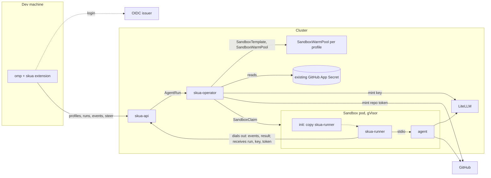

Status: approved
Updated: 2026-11-03
Owner: orchestrator

# Proposal: skua platform shape

**Recommendation:** Build skua as an installable product with four parts:
- `skua-operator` turns each installer-declared profile into an agent-sandbox warm pool, turns each run into a claim on that pool, and cleans up.
- `skua-api` is the broker API: login, the profile list, runs, live events, steer, results.
- `skua-runner` is injected into every sandbox pod by an init container, so any image with the agent and its tools works without setup. It drives the agent (omp in RPC mode for the MVP).
- The skua omp extension logs in, asks `skua-api` for the profile list, and shows each profile as a remote agent that `task` can spawn next to local agents.

A remote run returns what a local subagent returns: a text report or schema-checked JSON, plus whatever it did through git (a branch, a PR). No files and no volumes.

**Key tradeoff:** remote agents appear in omp through a model provider, because skua does not change omp. Each remote run is a local Agent Hub row whose turns are relayed from the cluster, with a local `skua_step` tool call at each remote tool call so omp shows tool cards and delivers steers. The spike confirmed this on omp 18.16.0; it depends on omp's extension provider API, which can change with any release.

**Needs your call:** nothing. Approved 2026-11-03; investigations and specs follow.

## Problem

Devs want to hand long-running work to coding agents in a shared Kubernetes cluster, then steer and collect that work from omp on their own machine: implementing spec units, fixing issues, research that returns text or JSON. A remote agent should behave like a local subagent. Installers choose which profiles exist; devs pick one per task. skua is a generic application any team installs on its own cluster. Nothing exists yet except the agent harness.

## Constraints

- Long-running agents run in a k8s cluster; devs orchestrate them from local omp. (dev)
- From omp, `task` targets remote agents next to local ones, and remote agents show in omp's subagent window. Other harnesses are post-MVP but must stay possible. (dev, D-1)
- The sandbox agent is pluggable: pi, Pi Durable, omp or a custom agent. (dev, D-2)
- A remote run returns text, structured JSON, or git changes up to a PR, like a local subagent; nothing highly custom. (dev, D-3, D-17)
- No volumes. If files are ever needed, they go through an S3 bucket with signed URLs the dev machine fetches. (dev, D-17)
- Inference goes through LiteLLM with per-run virtual keys; pods never hold provider keys. (dev, D-4, D-6)
- Installers declare several profiles, each with its own image and model; each gets its own agent-sandbox pool. (dev, D-7, D-21)
- Custom images should not need the runner set up by hand. (dev, D-19)
- GitHub access reuses a GitHub App the cluster already has (for example Flux's); skua provisions nothing. Agents use `gh` and `git`. Optional. (dev, D-8, D-16, D-18)
- Devs see only their own runs, for convenience rather than security. Dead agents get cleaned up. (dev, D-9)
- Agents may read from anywhere but should not mutate anything outside their sandbox except through git. (dev, D-10)
- skua changes only this repo, never omp. (dev, D-11)
- Generic product: any OIDC issuer, installer config, intranet clusters, kind for local testing. (dev, D-12)
- After login, the extension asks the cluster for the agent list. One skua endpoint per dev for now. (dev, D-20)
- A sandbox provider is required: agent-sandbox. (dev, D-15)
- The repo harness uses `.agents/` wherever omp reads it. (dev, D-5)

Research with sources: `platform.notes.md`. Review findings and dispositions: `platform.findings.md`.

## Proposed design



### Components

| Component | Runs | Job |
| --- | --- | --- |
| `skua-operator` | Deployment, Go, controller-runtime | Owns the CRDs. Per profile: a `SandboxTemplate` and a `SandboxWarmPool`. Per run: a `SandboxClaim`, a LiteLLM key, repo tokens minted from the existing App Secret, phase, cleanup. |
| `skua-api` | Deployment, one replica in the MVP, Go, no volume | Validates OIDC tokens, lists `Ready` profiles, creates and lists the caller's runs, accepts runner connections, relays events, steer and abort, hands a claimed runner its run and credentials. |
| `skua-runner` | static Go binary, injected into the agent container | Waits for an assignment, prepares the workspace, writes the agent's model config, starts the agent through an adapter, streams sequenced events, reports the result, installs git and `gh` auth helpers. |
| skua omp extension | dev machine, TypeScript | Login, profile list, one remote agent per profile, the relay provider, `/skua` commands. |

One Go module and one image for operator, API and runner. No CLI in the MVP. A CLI and `skua mcp` for other harnesses come later on the same API.

### Profiles and warm pools

A profile is a cluster-scoped `AgentProfile` an installer declares. It is the only thing a dev chooses.

```yaml
apiVersion: skua.dev/v1alpha1
kind: AgentProfile
metadata: { name: golang }
spec:
  description: "Go 1.26 toolchain, golangci-lint, gh. Use for Go repos."
  image: registry.example/skua/agent-golang@sha256:...   # needs the agent, git, gh, the toolchain; not the runner
  adapter: omp-rpc                 # only value in the MVP
  command: ["omp", "--mode", "rpc"]
  models: [anthropic/claude-sonnet-5, anthropic/claude-haiku-4-5]   # first is primary; the rest serve omp's helper roles
  runtimeClassName: gvisor
  resources: { requests: { cpu: "2", memory: 4Gi } }
  workspace: { size: 20Gi }        # optional storageClassName: a scratch disk that lives and dies with the pod
  warmPool: { replicas: 2 }        # 0 means every claim cold-starts
  forge: github                    # github | none
  limits: { budgetUSD: 10, maxRuntime: 4h, maxRestarts: 3, maxResultBytes: 262144 }
status:
  conditions: [{ type: Ready }]    # false when a model is unknown to LiteLLM or the pool cannot start
```

- The operator renders each profile into an agent-sandbox `SandboxTemplate` (pod spec, RuntimeClass, NetworkPolicy, no service account token automount) and a `SandboxWarmPool` with the profile's replica count. An `AgentRun` becomes a `SandboxClaim` on that pool. With no ready pod, agent-sandbox cold-starts one from the template.
- Claims carry no per-run env or volumes, because either forces a cold start. Everything per run (repo, prompt, LiteLLM key, GitHub token) reaches the runner over its connection after the claim binds.
- The workspace is scratch space that lives and dies with the pod: an `emptyDir` limited to `workspace.size`, or, when the profile names a `storageClassName`, a generic ephemeral volume of that size, which Kubernetes creates with the pod and deletes with it. Nothing outlives the run. `skua-api` and the operator use no volumes at all.
- skua ships a `generic` image (git, gh, shells, omp). Language images build on it or on anything else.

### Runner injection

- The template adds an init container from skua's image that copies the static `skua-runner` binary and its helper shims into a shared `emptyDir` at `/skua/bin`.
- The agent container's command becomes `/skua/bin/skua-runner run -- <profile command>`. The runner is PID 1 of the agent container and starts the agent as its child over stdio, which is how the `omp-rpc` and `acp` adapters talk. As PID 1 it reaps orphans and owns every process in the container.
- Cancel and restart kill the whole container's process tree, not only the agent: omp's RPC `abort` leaves background shell jobs running in their own sessions, and after a crash the cut tool's child keeps running and can repeat its side effects when the agent retries.
- Resume after a crash: the runner kills leftover processes, restarts omp, calls `open_session` on the same session directory, and sends one resume prompt. `open_session` restores the session and model but does not continue the interrupted turn by itself.
- Model config: the runner writes omp's `models.yml` with one LiteLLM provider and sets `enabledModels` plus `modelRoles` (`default` is the profile's first model, `smol` and `tiny` the rest), which also hides omp's implicit local providers. Claude models get explicit `api: anthropic-messages` entries with `auth: apiKey`, because omp's LiteLLM discovery maps every non-OpenAI model to chat completions.
- git auth: the runner sets `GIT_CONFIG_COUNT`, `GIT_CONFIG_KEY_0=credential.helper` and `GIT_CONFIG_VALUE_0=skua` in the agent's environment, so no gitconfig or writable `HOME` is needed; `gh` is a shim on `PATH`.
- A custom image needs only Linux, the agent, `git`, `gh` and its toolchain. It needs no runner, no skua config and no entrypoint.
- A sidecar runner loses because it cannot hold the agent's stdin and stdout across containers.

### Agent-facing surface

The runner wraps the agent for lifecycle, live events, steering and credentials. The agent also gets two things it can use directly:
- A `skua` MCP server with `submit_result`, whose input schema is the run's `task.schema` when one is set. For omp the runner writes the pod's MCP config with `tools.xdev: false`, so the tool is a top-level tool; omp itself spawns `skua-runner mcp` as a stdio child, which hands the result to the PID 1 runner over a unix socket in `/skua/run`. omp validates arguments against the schema and returns errors to the model. ACP agents receive the server in `session/new`. If the agent never calls it, its final message is the result.
- A `skua-run` skill, which the runner writes to the workspace's `.agents/skills/`: push to `skua/<run>`, open the PR with `gh`, keep large output in git, submit the result through the tool.

### Adapters

| Adapter | Agents | What the agent must do |
| --- | --- | --- |
| `omp-rpc` (MVP) | omp | run `omp --mode rpc` |
| `acp` (later) | Claude Agent and Codex through their ACP adapters, Copilot, pi via `pi-acp`, `omp acp`, custom ACP agents | speak ACP over stdio |
| `exec` (later) | a Pi Durable host, scripts, anything else | read `/skua/run/task.json`, write `/skua/run/result.json`, exit 0 |

### Run contract

```yaml
apiVersion: skua.dev/v1alpha1
kind: AgentRun
metadata:
  generateName: golang-
  namespace: skua
  labels: { skua.dev/owner: <40-hex sha256 of issuer and subject> }
spec:                              # immutable after create
  profile: golang
  clientKey: <omp child session id>:<follow-up n>   # idempotency: one run per key per owner
  workspace: { repo: org/service-a, baseRef: 3f2c9e1 }   # optional
  task: { prompt: "...", schema: {} }                    # schema optional, JSON Schema 2020-12
status:
  phase: Succeeded                 # Pending | Running | Succeeded | Failed
  reason: Completed                # Completed, Cancelled, MaxRuntime, BudgetExceeded, CrashLoop, ...
  claim: golang-x7k2p
  profileSnapshot: {}
  result: "..."                    # text report or schema-checked JSON, at most maxResultBytes
  outputs: { branch: skua/golang-x7k2p, pullRequest: 87 }
```

- The result is text or JSON and lives in `status.result`, capped at `maxResultBytes` (default 256 KiB, well under etcd's limit). Anything larger goes through git: the agent commits it to its branch and the result names the path.
- With a `schema`, the agent submits through `submit_result`, which validates against it. A final message without a valid submission gets one re-prompt from the runner.
- No transcript is stored in the cluster. The local omp child session already holds the relayed conversation, which is what `history://` reads.

### Task item mapping

| `AgentRun` field | Comes from |
| --- | --- |
| `profile` | the remote agent the `task` item names (`skua-golang`) |
| `clientKey` | the omp child session id plus a follow-up counter, so a retry or reconnect reuses the run and each follow-up gets a new one |
| `workspace.repo`, `baseRef` | the local repo's `origin` and `HEAD`. The extension refuses the item when `HEAD` is not pushed, so remote agents see what the orchestrator wrote. |
| `task.prompt` | the item's assignment plus the batch `context` |
| `task.schema` | the item's output schema when omp's `task.structured` is on |

### Runner wire

- A warm pod's runner opens a Server-Sent Events stream to `skua-api` (`GET /runner/stream`) and authenticates with a projected service account token whose audience is `skua-api`. TokenReview, through a `system:auth-delegator` binding, returns the pod name and uid; `skua-api` finds the claim from the pod's `agents.x-k8s.io/claim-uid` label (a cold-started claim gets no sandbox-name annotation) and the run from the claim. It needs `get` on pods and claims in the sandbox namespace. The token proves only "I am this pod".
- Commands flow down that stream: the run assignment, steer, abort and token refreshes, each with an id, so a reconnect resumes with `Last-Event-ID`. Events flow up as batched `POST /runner/events` requests; each event carries a sequence number, `skua-api` ignores sequences it already has, and the response acknowledges the highest one. The extension uses the same shape: an SSE stream per run plus `POST` for steer and abort. Plain HTTP keeps one client pattern for both, makes every message a request a proxy, a log or `curl` can see, and gives resume and acknowledgement without a custom framing layer.
- When a claim binds, `skua-api` sends the runner its run: repo, base ref, prompt, schema, the LiteLLM key and, with `forge: github`, the repo token. The operator mints both and keeps them in a per-run Secret in skua's own namespace, owned by the `AgentRun` and never mounted into a sandbox; `skua-api` reads it and forwards. The runner writes the token where the git helper and `gh` shim read it, then starts the agent.
- The agent shares the runner's container and can read the projected token. `skua-api` accepts one stream per pod, and the runner opens it before the agent starts, so the agent cannot take over the run's channel.
- The runner keeps a bounded in-memory buffer of unacknowledged events and re-posts them after a failure.
- `skua-api` keeps each live run's events in memory until the run is terminal, and the extension resumes with `Last-Event-ID`. A `skua-api` restart loses that history; the extension then rebuilds from what the runner still buffers and from the final `status.result`. Logs are live only: a finished run has its result, not its event stream.
- A steer on a finished run returns 409, and the extension starts a follow-up run instead.
- No long polling anywhere (D-24). Both SSE streams are single long-lived responses that push each message as it happens; no endpoint holds a request open waiting for one message and then closes.
- At the end the runner sends the result; `skua-api` writes it to `status.result` and acknowledges; the runner exits.

### How omp sees remote runs

- After login, the extension calls `GET /profiles` and writes one task agent file per `Ready` profile (`skua-golang.md`, `skua-node.md`) into its package's `agents/` folder, with the relay provider as model. It loads the cached list at startup and refreshes in the background and on `/skua sync`, because the extension's startup runs again for every child session and a slow API would delay each spawn. New profiles are dispatchable after a sync without restarting omp. `fetchDynamicModels` is not used: omp caches its result for 24 hours.
- Each remote item is an Agent Hub row. `agent://<id>` and `history://<id>` read the relayed conversation from the local session.
- Turn shape: the relay provider ends each relayed assistant message at every remote tool call with a call to a local `skua_step` tool, whose call id carries the run name and event sequence. omp shows these as tool cards and delivers a steer at that tool boundary, so a steer reaches `skua-api` within one remote step. Extension tools stay available to a child with `tools: []`. With a plain text relay the steer waited until the run ended. Inside the pod, omp's RPC mode applies a steer after the running tool or message finishes and takes queued steers one at a time, so a steer sent during a long build lands when the build ends; the runner coalesces queued steers into one.
- Optional: with omp's `providers.openaiLiveSteering` on, the provider also receives steers mid-stream (2 to 3 ms in the spike). That setting also changes the dev's GPT models, so skua never turns it on.
- Every omp abort signal (Esc, Agent Hub kill, closing omp) reaches the provider as the same signal, so the relay always detaches and the run continues. Cancel is `/skua abort`.
- Steers arrive wrapped (`<system-notice>` from the dev, `<irc>` from a parent agent). omp's own "no tool call" reminders arrive the same way and must never become steers or follow-ups.
- When a remote run fails, the relay ends the child's turn with a normal final message stating the reason; omp does not retry it. omp applies no idle timeout to extension providers, so the relay watches a heartbeat on the event stream itself.
- The task result is `status.result` plus `outputs`; a schema run's JSON passes omp's own schema check.

### Lifecycle and cleanup

- Every object a run creates has an owner reference to its `AgentRun`. A finalizer revokes the LiteLLM key with a bounded wait.
- A run fails with a reason when it exceeds `maxRuntime`, when its container restarts more than `maxRestarts` times, or when the runner reports a budget, key or agent error. A container restart keeps the workspace; losing the pod (eviction, node loss, size overrun) loses it, and the run fails with reason `PodLost`.
- On any terminal phase the operator revokes the key and deletes the claim; the claim owns its Sandbox, so the pod goes with it (1 to 1.5 s in kind). The warm pool refills in about 2 s. A claimed warm pod is Ready in about 0.5 s; a cold claim takes about 2 s plus any image pull.
- The `AgentRun` and its result stay for a retention period that starts when the owner first fetches the result, capped by an installer maximum (default 7 days).

### Credentials and network

- The installer points skua at a GitHub App Secret that already exists, by namespace and name, with Flux's key names as the default (`githubAppID`, `githubAppInstallationID`, `githubAppPrivateKey`). skua gets `get` on that one Secret through a Role with `resourceNames`, and the operator reads it uncached, since a cached client would need list and watch on every Secret. The App must have `contents` and `pull_requests` write and be installed on the repos agents work on; an App installed read-only for Flux is not enough.
- The operator mints a one-hour token for the run's one repo and re-mints every 30 minutes; `skua-api` pushes each new token to the runner. Old tokens are not revoked on refresh, they expire on their own; every token is revoked when the run ends. The runner's git credential helper and `gh` shim (both in `/skua/bin`, first on the agent's `PATH`) read the current token and refuse one with under 5 minutes left. The agent uses `gh` and `git` normally (D-16). The App key never enters a sandbox (D-22).
- The token cannot limit pushes to `skua/*` or force review. The install docs require a repo ruleset that blocks the App from other refs and requires an approving review.
- The pod holds a LiteLLM key limited to the profile's models, budget and `maxRuntime`, minted with an operator-chosen value, the alias `skua-<run-uid>` and `key_type: llm_api`. With the default key type a run key could delete or read a sibling run's key; `llm_api` blocks every management route. A retried mint gets 400 on the alias, and the operator confirms with `/key/info`. Delete is by alias; a 404 counts as done.
- The operator holds a LiteLLM `internal_user` key limited by `allowed_routes` to `/key/generate`, `/key/delete`, `/key/info` and `/model_group/info`, created once by the installer; never the master key. The profile `Ready` check calls `/model_group/info`, since `/key/generate` accepts unknown model names.
- Budget, expiry and key deletion stop new requests but never cut an open stream, so the operator enforces `maxRuntime` by deleting the claim. A deleted key stays usable on another LiteLLM replica for up to the auth cache TTL; the install docs set `user_api_key_cache_ttl` to 10 s.
- NetworkPolicy, set in the `SandboxTemplate`: egress open except cluster-internal ranges, with exceptions for DNS, LiteLLM and `skua-api`; ingress denied. The installer supplies the pod, service and node CIDRs, and the CNI must enforce NetworkPolicy.
- Pods: gVisor RuntimeClass (kind maps the same name to runc), Pod Security `restricted`, only the projected `skua-api` token mounted.

### Files, if they are ever needed

Not in the MVP. If a use case appears that text and git do not cover, an optional `ArtifactStore` integration takes an S3 bucket: `skua-api` hands the runner a presigned PUT URL per file, and the extension a presigned GET URL, so neither the pod nor the laptop holds bucket credentials. The extension saves files to a temp folder and returns their paths. Scratch docs, the example use case, fit git or a text result today.

### Validation and versioning

- CRD CEL rules cover single-object checks. `skua-api` checks cross-object rules (profile exists and is `Ready`); the operator re-checks at reconcile for runs created with `kubectl`.
- `skua-api` serves `/v1alpha1`. The runner reports its version when it connects; the API refuses runners outside the supported range. The runner comes from skua's image through the init container, so it upgrades with skua, not with the installer's agent images.
- CRDs ship outside the Helm chart's upgrade path because Helm does not upgrade CRDs. The operator checks the installed agent-sandbox version range at startup and reports, rather than crash-looping, when it is outside.

### Alternatives considered

- **kagent + Agent Substrate.** The closest platform, but alpha, and agents must implement its A2A contract.
- **OpenHands, Coder Agents.** Multi-user OpenHands is a non-OSS Enterprise product. Coder Agents runs its own agent loop, is AGPL, and caps free use at 5 agents.
- **Runner baked into each image, or as a sidecar.** Baking puts setup on every image author. A sidecar cannot hold the agent's stdio.
- **MCP server or skill instead of a wrapper.** An MCP server runs only when the agent calls it, so it cannot start the agent, see every event, or push a steer. It complements the wrapper for results and conventions.
- **Per-run env or volumes on the claim.** Either forces a cold start and skips the warm pool.
- **Per-call `model` on one `remote` agent.** omp's `task.perCallModel` is off by default and each model must be granted in every dev's global config.
- **PVCs for workspace or results.** Ruled out by D-17.

## Risks

- omp's extension provider API may change in a release, breaking the relay or the `skua_step` turn shape. → Pin the tested omp range in the extension; the scheduled CI job reruns the omp-native spike against the newest omp.
- omp updates almost daily and the extension runs in-process. → Version-range check, scheduled CI against the newest omp, `ctx` timers only.
- Losing the pod loses unpushed work. → The run fails with `PodLost`; agents can push work-in-progress commits to their branch.
- Warm pods idle at their requested CPU and memory. → `warmPool.replicas` per profile, 0 allowed; the pool's `/scale` subresource lets an installer autoscale it.
- One `skua-api` replica is a single point of failure for live runs. → Runners buffer and reconnect.
- LiteLLM supply-chain history. → Pin digests and verify cosign (v1.106.6 verified against the e82a3c6 key); upgrade only to releases older than a few days.
- `network: open` lets an injected agent post data anywhere without credentials. → Accepted by D-10.
- gVisor may slow installs and builds (inferred). → Measure on a real node (cluster-readiness R5). Workspace writes under gVisor count as ephemeral storage, not memory, and evict the pod at the limit (measured in kind).

## Investigations before a spec

| Doc | Question |
| --- | --- |
| `agent-wire.investigation.md` | How the injected runner drives `omp-rpc` in a warm pod, receives its run after the claim binds, refreshes the token, detects failure, and reconnects. |
| `omp-native.investigation.md` | Whether the relay provider gives Agent Hub rows, steering and results that hold up for hours, which turn shape works, and how the profile list reaches omp. |
| `cluster-readiness.investigation.md` | What an installer's cluster must provide, and the kind test environment. |
| `gateway.investigation.md` | Whether LiteLLM passes omp's traffic intact, enforces per-key model lists, and mints idempotently without Enterprise. |

## Execution sketch

1. Investigations above; the omp-native relay spike runs first because the key tradeoff rests on it.
2. Walking skeleton in kind: CRDs, operator, API with Dex, agent-sandbox with one warm pool, injected runner with `omp-rpc`, the `generic` profile, LiteLLM keys, a test GitHub App Secret in Flux's format, cleanup. Done when one run opens a PR on a test repo and one research run returns schema-valid JSON.
3. omp extension: profile list, remote agents, relay, steering.
4. Install docs and Helm chart, gVisor on a real cluster, ruleset checks.
5. `acp` and `exec` adapters, language images, CLI and `skua mcp`; `ArtifactStore` only if a use case appears.

## Open questions

None. Further questions come out of the investigations.

## Decisions

- D-1 (dev, 2026-11-03): "omp native" means from local omp the dev spins up remote agents, `task` can use remote agents alongside local ones, and remote agents show in the omp subagent window. Other harnesses (Copilot, Antigravity, Claude Code, Codex) using them is a stretch goal outside the MVP, but useful for the architecture.
- D-2 (dev, 2026-11-03): The sandbox agent is pluggable: pi, Pi Durable, omp, another long-running agent, or a customized one. `omp --mode rpc` is likely the easiest MVP runtime. (answers Q1)
- D-3 (dev, 2026-11-03): A remote run is universal like a local subagent: clone, edit, build, test and push a PR; or an investigation that returns a document artifact or structured JSON against a schema. Do not build something highly custom yet. (answers Q2)
- D-4 (dev, 2026-11-03): Agents bill through a gateway; sandbox pods use virtual keys, never real provider keys. Simplify for the MVP. (answers Q3)
- D-5 (dev, 2026-11-03): The dev uses only omp; the repo harness uses `.agents/` wherever omp reads it.
- D-6 (dev, 2026-11-03): LiteLLM is the gateway. (answers Q4)
- D-7 (dev, 2026-11-03): Installers declare several runner types through the broker (for example generic, node, golang); devs use any of them; each may register as a different remote agent type in omp, and its config includes the model it uses. The broker may be two parts, an operator and a broker API. (answers Q10)
- D-8 (dev, 2026-11-03): A GitHub App manages GitHub auth, with a secret in the cluster for the sandbox pod; agents use the `gh` CLI and git. It is optional, for installs that do not use GitHub. (answers Q6)
- D-9 (dev, 2026-11-03): Devs are isolated from each other's runs as a UX convenience. Dead agents must be cleaned up. (answers Q7)
- D-10 (dev, 2026-11-03): Agents stay fairly agnostic and may pull from remote repos and search the web, but should not mutate anything outside their sandbox except through git. (answers Q8)
- D-11 (dev, 2026-11-03): No changes to omp. skua touches only this repo. (answers Q9)
- D-12 (dev, 2026-11-03): skua is a generic application anyone can install and configure on their own cluster, not a dedicated instance. Practically an intranet tool on a private cluster; local testing uses kind. Identity is generic OIDC. (answers Q5, Q13, Q14, Q15)
- D-13 (dev, 2026-11-03): How artifacts reach the local omp agent is open; S3 is possible but should be avoided. (answers Q12)
- D-14 (dev, 2026-11-03): Revival of finished runs is a maybe; ideally a local orchestrator can read `history://` of a remote agent. (answers Q11)
- D-15 (dev, 2026-11-03): A sandboxing provider is required; agent-sandbox stays a prerequisite behind `SandboxProvider`. (answers Q18)
- D-16 (dev, 2026-11-03): Agents (omp) have `gh` set up and use it themselves; skua must provide the way that auth gets set up. (answers Q19)
- D-17 (dev, 2026-11-03): Prefer no artifacts; runs return text or do git things. If files turn out to be needed for a reasonable use case, no volumes: use an S3 bucket with a signed URL the dev machine calls to fetch the file into temp or `local://`. (refines D-13)
- D-18 (dev, 2026-11-03): The cluster operator already has a GitHub App set up (for Flux or similar) with its Secret present in the cluster. skua provisions nothing; at most it has config for how sandbox pods get credentials from that Secret.
- D-19 (dev, 2026-11-03): People should be able to use custom images without setting up the runner themselves.
- D-20 (dev, 2026-11-03): Once authenticated, the omp extension asks skua for the agent list. Connecting one dev to several skua installs is out of scope for now.
- D-21 (dev, 2026-11-03): Each agent definition gets its own agent-sandbox pool with warm pool support.
- D-22 (dev, 2026-11-03): Never the App key in a pod. Minting short-lived tokens from it is fine. (answers Q20)
- D-23 (dev, 2026-11-03): A follow-up after a run finishes starts a new run. Scratch disks for sandbox pods from the pool are fine; only the API must not use a volume. History after a task finishes matters little; an orchestrator checks an agent while it runs, for example when it seems to be spinning. (answers Q21)
- D-24 (dev, 2026-11-03): No long polling (the old technique of holding a slow request open until one message arrives); it is strictly banned. SSE following the current spec is allowed.
- D-25 (dev, 2026-11-03): No real GitHub repo, App or PR testing; `gh` being available is enough for now. No Ollama; if an LLM is needed in kind, use something like vLLM with a tiny model. No API keys, no real-cluster checks, no cosign for now. Prefer automated tests over one-off environment testing, with abstractions that let tests mock real-world limits and integrations.
- D-26 (dev, 2026-11-03): The repo is the personal project `Devcon4/skua`, not `Centeva/skua`; module path `github.com/Devcon4/skua`, registry `ghcr.io/devcon4`.

## Review log

- Pitch check round 1 (2026-11-03): Q1 to Q3 answered (D-1 to D-5). Moved to a runner with adapters and three output kinds.
- Pitch check round 2 (2026-11-03): Q4 to Q15 answered (D-6 to D-14). Added profiles, operator and API split, ownership and cleanup, local artifact download; removed per-dev namespaces and impersonation.
- Board round 1 (2026-11-03, large, mode: parallel, 7 lenses): findings in `platform.findings.md`. Facts fixed: steering not proven, network policy needs, PVC ownership, LiteLLM key listing, omp per-call model and structured output. Risks fixed: runner wire, idempotency, terminal failures, token refresh, result retention, extension drift. Scope cuts accepted: CLI, `network: allowlist`, key sweep, per-run model, seven phases, `ForgeProvider` interface. Raised Q18 and Q19; Q16 and Q17 removed (allowlist cut; web search moved to gateway branch B9). Net about +40 lines.
- Round 1 answers (2026-11-03): Q18 and Q19 answered by D-15 and D-16. Plain-Pod sandbox rejected; the agent keeps the write token with an installer ruleset required. No open questions.
- Pitch check round 3 (2026-11-03): D-17 to D-21. Removed artifacts, every PVC and the `skua-api` store; results live in `status.result`, larger outputs go through git, files through S3 presigned URLs only if needed. Runner injected by an init container. Profiles become `SandboxTemplate` plus `SandboxWarmPool`; runs become claims and get their data over the runner socket. GitHub tokens are minted from an existing App Secret. Raised Q20 and Q21.
- Round 3 answers (2026-11-03): D-22 and D-23. Workspace may be a per-pod ephemeral volume from a storage class. No open questions.
